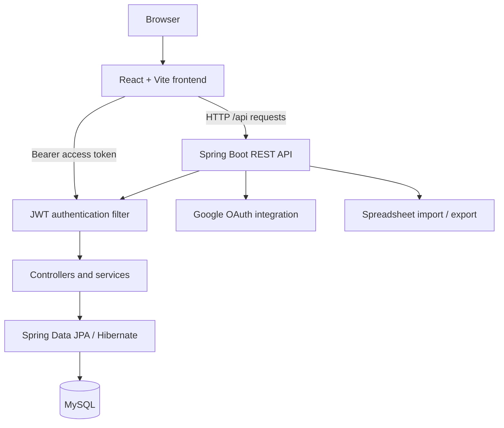

# Campus Lost & Found

A campus lost-and-found platform built with **React, Vite, Java 21, Spring Boot, Spring Security, JWT, and MySQL**. It lets users report lost or found items, browse reports, submit claims, and track claim status. Administrators can manage reports, claims, users, desk inventory, and data exports.

> This documentation describes the current repository structure and configuration. Verify all environment values for your own machine. Do not commit secrets or production credentials.

## Contents

- [Features](#features)
- [Technology](#technology)
- [Architecture](#architecture)
- [Repository layout](#repository-layout)
- [Requirements](#requirements)
- [Setup](#setup)
- [Environment configuration](#environment-configuration)
- [Run the application](#run-the-application)
- [User workflows](#user-workflows)
- [API overview](#api-overview)
- [Authentication and access](#authentication-and-access)
- [Database](#database)
- [Tests and build checks](#tests-and-build-checks)
- [Troubleshooting](#troubleshooting)
- [Security notes](#security-notes)
- [Documentation index](#documentation-index)
- [Contributing](#contributing)
- [License](#license)

## Features

### User functions
- Register and sign in with an email and password.
- Sign in through Google OAuth when the OAuth client is configured.
- Browse lost and found reports.
- Create, view, update, and delete item reports, subject to server-side access rules.
- View item details and reporter information returned by the API.
- Submit claims with a proof description.
- View personal claims and their status.
- Refresh an expired access token by using a refresh token.
- Edit the user profile where supported by the current API.

### Administrator functions
- View the administration dashboard.
- Review and update claim statuses.
- Manage item reports and users.
- Manage desk inventory, including bulk import from spreadsheet files.
- Export administrative data.

The backend is the authority for permissions. Hiding a page in the frontend does not replace backend access checks.

## Technology

| Layer | Technology |
|---|---|
| Frontend | React 19, Vite 8, React Router |
| UI and motion | Tailwind CSS 4, Radix UI, Lucide, Framer Motion, GSAP, Lenis |
| HTTP | Fetch API wrapper in `frontend/src/lib/api.js` |
| Backend | Java 21, Spring Boot 4.1.0, Spring MVC |
| Security | Spring Security, JWT, refresh tokens, Google OAuth client |
| Persistence | Spring Data JPA / Hibernate |
| Database | MySQL with MySQL Connector/J |
| Validation | Spring Boot Validation |
| Export | Apache POI for spreadsheet processing |
| Build | Maven and npm |

## Architecture



The frontend uses `VITE_API_BASE_URL` to find the API. Its default is `http://localhost:8080/api`. The backend reads database, JWT, CORS, admin-seed, and Google OAuth settings from environment variables.

See [Architecture](docs/ARCHITECTURE.md) for component responsibilities and request flow.

## Repository layout

```text
LostNFound_System/
├── backend/
│   ├── pom.xml
│   └── src/main/
│       ├── java/com/example/backend/
│       │   ├── config/          # Spring Security and application configuration
│       │   ├── controller/      # REST controllers
│       │   ├── dto/             # Request and response models
│       │   ├── entity/          # JPA entities
│       │   ├── exception/       # API exception handling
│       │   ├── repository/      # Spring Data repositories
│       │   ├── security/        # JWT and authentication filters
│       │   └── service/         # Business logic
│       └── resources/
│           └── application.properties
├── frontend/
│   ├── package.json
│   ├── vite.config.js
│   └── src/
│       ├── components/
│       ├── context/
│       ├── hooks/
│       ├── lib/api.js           # API client and token handling
│       ├── pages/auth/
│       ├── pages/student/
│       └── pages/admin/
├── docs/
│   ├── API_REFERENCE.md
│   ├── ARCHITECTURE.md
│   ├── CONTRIBUTING.md
│   └── SECURITY.md
└── README.md
```

## Requirements

Install these tools before you start:

- **Git**
- **JDK 21** (the backend Maven configuration sets Java 21)
- **Maven 3.9+** recommended
- **Node.js** compatible with Vite 8 and **npm**
- **MySQL 8.x** recommended

Check the installed versions:

```bash
git --version
java -version
mvn -version
node --version
npm --version
mysql --version
```

## Setup

### 1. Clone the repository

```bash
git clone https://github.com/KrishCodesw/LostNFound_System.git
cd LostNFound_System
```

### 2. Create the MySQL database

Start MySQL, then run:

```sql
CREATE DATABASE lost_and_found
  CHARACTER SET utf8mb4
  COLLATE utf8mb4_unicode_ci;
```

Create a database user for the application instead of using the MySQL root account:

```sql
CREATE USER 'lostfound_app'@'localhost' IDENTIFIED BY 'replace-with-a-strong-password';
GRANT ALL PRIVILEGES ON lost_and_found.* TO 'lostfound_app'@'localhost';
FLUSH PRIVILEGES;
```

The current backend configuration uses Hibernate schema update (`spring.jpa.hibernate.ddl-auto=update`). JPA entities define the tables. Review this setting before production use; use controlled database migrations for deployed environments.

### 3. Configure backend environment

Set the environment variables listed in [Environment configuration](#environment-configuration). The backend reads these values through Spring configuration placeholders. The repository uses dotenv-java as a dependency, but do not assume a `.env` file is loaded automatically by every launch method. Export the variables in your shell or configure them in your IDE/run environment.

**PowerShell example:**

```powershell
$env:DB_URL = "jdbc:mysql://localhost:3306/lost_and_found?useSSL=false&serverTimezone=UTC"
$env:DB_USERNAME = "lostfound_app"
$env:DB_PASSWORD = "replace-with-a-strong-password"
$env:JWT_SECRET = "REPLACE_WITH_A_LONG_RANDOM_SECRET"
$env:CORS_ALLOWED_ORIGINS = "http://localhost:5173"
```

Generate a strong JWT secret. Do not use the example placeholder as a real secret. Set the Google OAuth and admin seed values only when you need those functions.

### 4. Install frontend dependencies

```bash
cd frontend
npm install
cd ..
```

### 5. Start the backend

From the repository root:

```bash
cd backend
mvn spring-boot:run
```

The API uses port **8080** by default. The database must be reachable and the required environment variables must be set before startup.

### 6. Start the frontend

Open a second terminal:

```bash
cd frontend
npm run dev
```

Vite normally serves the app at `http://localhost:5173`. Open the URL printed by Vite.

## Environment configuration

| Variable | Required | Purpose |
|---|---:|---|
| `DB_URL` | Yes | JDBC URL for the MySQL database |
| `DB_USERNAME` | Yes | Database user |
| `DB_PASSWORD` | Yes | Database password |
| `JWT_SECRET` | Yes | Secret used to sign and verify JWTs; use a strong random value |
| `JWT_EXPIRATION_MS` | No | Access-token lifetime in milliseconds; default: `900000` (15 minutes) |
| `REFRESH_TOKEN_EXPIRATION_MS` | No | Refresh-token lifetime in milliseconds; default: `2592000000` (30 days) |
| `CORS_ALLOWED_ORIGINS` | No | Allowed frontend origin(s); default: `http://localhost:5173` |
| `ADMIN_EMAIL` | No | Email for optional initial admin seeding |
| `ADMIN_PASSWORD` | No | Password for optional initial admin seeding; keep it secret |
| `ADMIN_NAME` | No | Initial admin display name; default: `System Admin` |
| `GOOGLE_CLIENT_ID` | Required for Google OAuth | Google OAuth client ID |
| `GOOGLE_CLIENT_SECRET` | Required for Google OAuth | Google OAuth client secret |
| `GOOGLE_REDIRECT_URI` | No | OAuth callback URL; default: `http://localhost:5173/auth/google/callback` |
| `VITE_API_BASE_URL` | No | Frontend API base URL; default: `http://localhost:8080/api` |

Vite exposes variables with the `VITE_` prefix to browser code. Never put passwords, OAuth client secrets, or JWT secrets in a `VITE_` variable.

## Run the application

Run these processes in separate terminals:

| Process | Directory | Command | Default address |
|---|---|---|---|
| MySQL | System service | Start the MySQL service | `localhost:3306` |
| Backend | `backend/` | `mvn spring-boot:run` | `http://localhost:8080` |
| Frontend | `frontend/` | `npm run dev` | `http://localhost:5173` |

### Production builds

Frontend:

```bash
cd frontend
npm run build
npm run preview
```

Backend:

```bash
cd backend
mvn clean package
```

The frontend build output is written to `frontend/dist/`. The backend JAR is written to `backend/target/`. Configure the production API URL, CORS origins, secrets, HTTPS, and database access for your deployment environment.

## User workflows

### Report an item
1. Register or sign in.
2. Open the report form.
3. Select the item type: `LOST` or `FOUND`.
4. Enter the title, description, category, and location details requested by the form.
5. Submit the report.
6. Open the feed or item detail page to review the report.

### Submit a claim
1. Open an item that you believe belongs to you.
2. Submit a claim with the requested proof description.
3. Open **My Claims** to check its status.
4. An administrator reviews the claim and updates its status.

### Administrator workflow
1. Sign in with an account that has the `ADMIN` role.
2. Open the admin area.
3. Review the dashboard, item reports, claims, users, or desk inventory.
4. Apply changes only after checking the selected record.
5. Use the export function when a report is required.

## API overview

The REST API is rooted at `/api`. Main resource groups include:

| Resource | Base path | Purpose |
|---|---|---|
| Authentication | `/api/auth` | Registration, login, refresh, logout |
| Google authentication | `/api/auth/google` | Google sign-in flow |
| Items | `/api/items` | Lost and found reports |
| Categories | `/api/categories` | Item categories |
| Claims | `/api/claims` | Submit and manage claims |
| Users | `/api/users` | User-related operations |
| Admin users | `/api/admin/users` | Admin-only user management |
| Admin inventory | `/api/admin/inventory` | Desk inventory management |
| Admin export | `/api/admin/export` | Administrative data export |

See [API Reference](docs/API_REFERENCE.md). Treat the controller implementation as the final authority for HTTP methods, request fields, response fields, and access requirements.

## Authentication and access

- Login returns tokens used by the frontend API client.
- The frontend stores the access token and refresh token in browser local storage.
- Protected requests send the access token as a `Bearer` token.
- When a protected request returns `401`, the API client tries to refresh the access token once.
- The backend uses a JWT authentication filter and Spring Security access rules.
- Admin routes require the `ADMIN` role on the backend.

See [Security Notes](docs/SECURITY.md) for deployment risks and recommendations.

## Database

The main JPA entities include users, item reports, categories, claim requests, refresh tokens, and desk inventory. Relationships and constraints are defined in the backend entity classes. Hibernate currently updates the schema at startup.

For a fresh local setup:
1. Create the empty database.
2. Set database connection variables.
3. Start the backend.
4. Check backend logs for connection or schema errors.

Do not delete or modify a shared database to fix a local setup problem. Back up data before schema changes.

## Tests and build checks

Run the backend tests:

```bash
cd backend
mvn test
```

Build the frontend:

```bash
cd frontend
npm run build
```

Run the frontend lint command only if one is defined in the current `frontend/package.json`. The current package scripts define `dev`, `build`, and `preview`; they do not define a `lint` or `test` script.

Before a pull request, confirm that both commands finish successfully. A successful build does not replace manual testing of login, authorization, item reporting, claims, and admin operations.

## Troubleshooting

### Backend does not start
- Confirm Java 21 is active: `java -version`.
- Confirm Maven is available: `mvn -version`.
- Confirm all required environment variables are set in the same terminal or IDE run configuration.
- Check whether port 8080 is already in use.
- Read the first database, security, or configuration exception in the backend logs.

### MySQL connection fails
- Confirm the MySQL service is running.
- Confirm the database exists.
- Check `DB_URL`, `DB_USERNAME`, and `DB_PASSWORD`.
- Confirm that the database user has access from the configured host.
- Check that the JDBC URL includes the correct port and database name.

### Frontend cannot reach the API
- Confirm the backend is running on port 8080.
- Check `VITE_API_BASE_URL`.
- Check `CORS_ALLOWED_ORIGINS` on the backend.
- Inspect the browser Network tab and backend logs for the actual HTTP status and response.
- Restart Vite after changing environment variables.

### Login succeeds but a protected request fails
- Check that the access token is sent in the `Authorization: Bearer ...` header.
- Check whether the access token expired and the refresh token is valid.
- Confirm that the account has the required role.
- Do not rely on frontend route protection alone.

### Google sign-in fails
- Set the Google client ID and secret in the backend environment.
- Confirm the callback URL in Google Cloud matches `GOOGLE_REDIRECT_URI`.
- Confirm the frontend callback route is `/auth/google/callback`.
- Check browser and backend logs. Do not publish OAuth secrets in an issue.

## Security notes

- Use strong, unique secrets for JWT signing and database access.
- Do not commit `.env` files, private keys, OAuth secrets, passwords, or production data.
- Use HTTPS in production.
- Restrict CORS to known frontend origins.
- Replace schema auto-update with versioned migrations before production.
- Review local-storage token risks and use a hardened token strategy for sensitive deployments.
- Review account registration and admin-seeding rules before public deployment.

See [Security Notes](docs/SECURITY.md).

## Documentation index

- [Architecture and request flow](docs/ARCHITECTURE.md)
- [API reference](docs/API_REFERENCE.md)
- [Security notes](docs/SECURITY.md)
- [Contributing guide](docs/CONTRIBUTING.md)

## Contributing

Bug reports and pull requests are welcome. Before you submit a change, read [Contributing](docs/CONTRIBUTING.md), run the backend tests, build the frontend, and include steps to reproduce any bug.

## License

No license file was confirmed during this documentation pass. Unless the repository adds a license, do not assume that others have permission to reuse, distribute, or modify the project. Add a suitable license file if you want to publish the project as open source.
