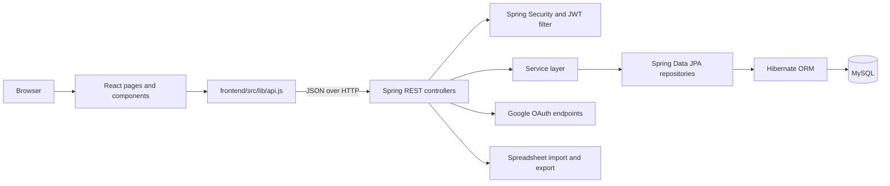

# Architecture

## System overview

Campus Lost & Found is a browser-based client and a Java REST API backed by MySQL.

## Frontend

- `frontend/src/App.jsx` declares authentication, student, and admin routes.
- `frontend/src/context/AuthContext.jsx` holds client authentication state.
- `frontend/src/lib/api.js` centralizes API calls, token storage, bearer headers, and one-time refresh attempts after eligible `401` responses.
- `frontend/src/pages/auth/` contains login, registration, and Google callback screens.
- `frontend/src/pages/student/` contains the item feed, item detail, report form, claims, and profile screens.
- `frontend/src/pages/admin/` contains dashboard, claim, item, inventory, and user screens.
- `frontend/src/components/` contains shared layouts and UI.

The frontend route guard improves navigation and user experience. It is not a security boundary.

## Backend

The backend follows a controller/service/repository design:

| Package | Responsibility |
|---|---|
| `config/` | Spring application and security configuration |
| `controller/` | HTTP routes, request handling, response status |
| `dto/` | API request and response objects |
| `entity/` | JPA database models |
| `exception/` | Central error mapping |
| `repository/` | Database queries through Spring Data |
| `security/` | JWT creation/validation and request authentication |
| `service/` | Business rules and persistence coordination |

The Maven project sets Java 21 and Spring Boot 4.1.0. Review the Maven file before changing framework versions.

## Request flow

1. A user action calls a function in the frontend API client.
2. The client sends JSON to the backend. For protected calls, it adds the access token as a bearer token.
3. Spring Security processes the request and the JWT authentication filter identifies the caller.
4. A controller validates and routes the request to the relevant service.
5. The service applies business rules and calls repositories.
6. JPA/Hibernate reads or writes MySQL data.
7. The controller returns a JSON response or an HTTP error.
8. If an eligible request returns `401`, the frontend attempts one refresh and retries once.

## Main domain entities

- **User**: account identity, credentials, and role.
- **Category**: shared item category.
- **Item**: a lost or found report, including its type and report details.
- **ClaimRequest**: a request to claim an item, including proof and review status.
- **RefreshToken**: refresh-token lifecycle data.
- **InventoryItem**: count-based items held by the campus lost-and-found desk. This differs from an individual lost/found report.

Check the entity classes for exact fields, constraints, and relationships.

## Configuration boundaries

- The frontend API base URL is configured by `VITE_API_BASE_URL`.
- The backend listens on port 8080 by default.
- Database access uses `DB_URL`, `DB_USERNAME`, and `DB_PASSWORD`.
- JWT lifetimes and signing secret use `JWT_EXPIRATION_MS`, `REFRESH_TOKEN_EXPIRATION_MS`, and `JWT_SECRET`.
- CORS origins use `CORS_ALLOWED_ORIGINS`.
- Google OAuth uses the Google client ID, client secret, and redirect URI.

## Persistence and migrations

The current configuration sets `spring.jpa.hibernate.ddl-auto=update`. This is convenient for local development, but it does not provide a reviewed migration history. For production, introduce a migration tool such as Flyway or Liquibase, set Hibernate to validate the schema, and test migrations against a database copy.

## Known design considerations

- Tokens are stored in browser local storage. Any successful cross-site scripting attack could expose them. See the security guide.
- The client uses a shared fetch wrapper. Keep its error handling and token-refresh behavior consistent across API calls.
- Admin access must be checked on the backend for every protected operation.
- The backend uses environment placeholders. Startup fails if a required value is missing or invalid.
- Do not document a response field or endpoint as guaranteed until it is checked against the current controller and DTO.
